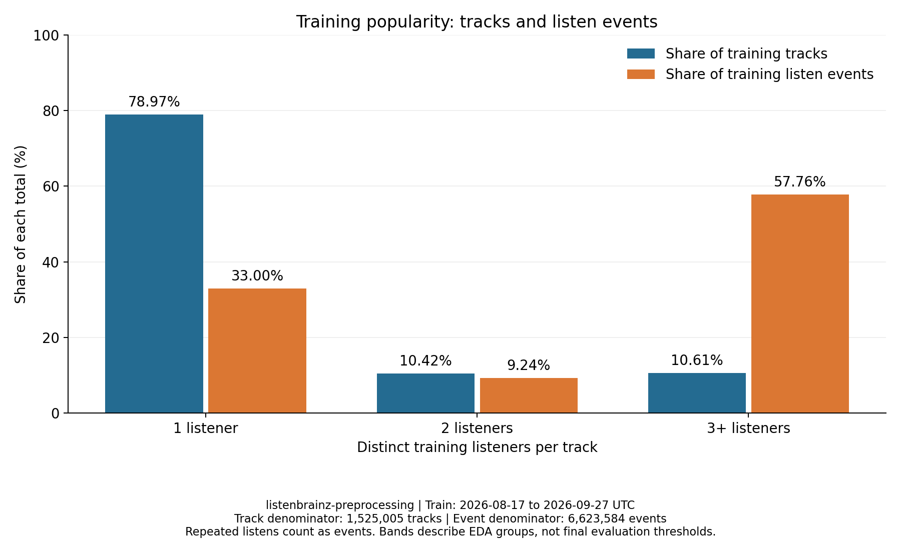
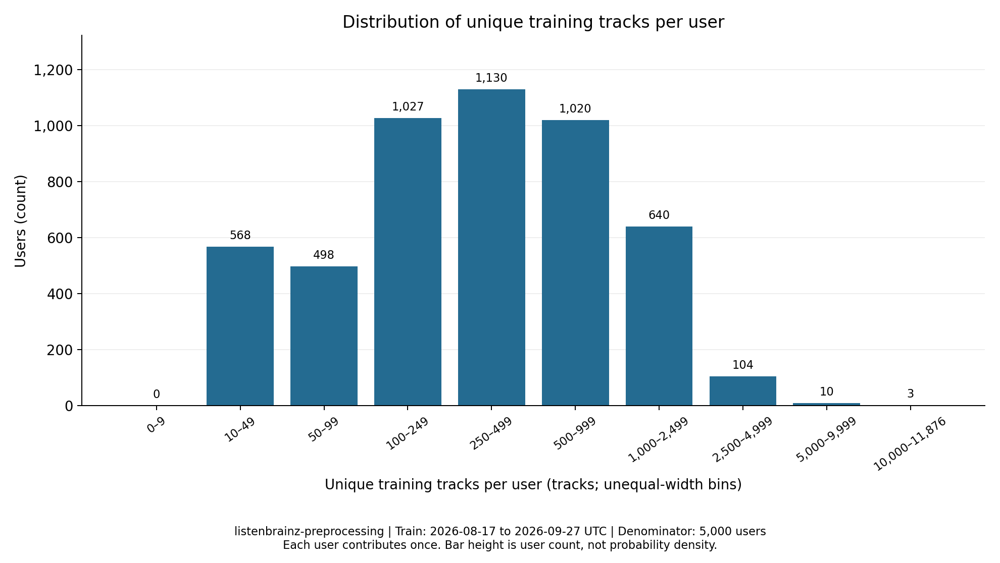

# CSV 학습 데이터의 인기도 분포와 평가 범위

`listenbrainz-preprocessing`의 선정 사용자 5,000명에서 학습곡의 78.97%는 청취자가 한 명이고, 이 곡들이 학습 청취 사건의 33.00%를 차지한다. 서로 다른 사용자의 학습 근거가 부족한 곡이 많으며, 반복 청취량과 고유 청취자 수를 구분해야 한다. 이 보고서는 모델 입력의 분포와 오프라인 평가 범위를 설명한다. 추천 출력과 모델 성능은 측정하지 않았다.

분석 근거는 [CSV 생성·원본 대조](csv-dataset-validation.md), [정제 영향·시간 분할 검증](temporal-split-review.md), [모델 적합성 검토](model-readiness-review.md)다.

## 데이터와 계산 범위

입력은 저장소의 `datasets/listenbrainz-preprocessing/`의 CSV 7개와 `dataset_manifest.json`이다. 데이터 계약은 `2.0.0`, 정제 규칙은 `1.0.0`이다. 원본 덤프는 ListenBrainz 2723이며, 전달본의 UTC 2026-08-17~10-11 청취를 사용한다. 원본 수집과 정제는 기존 코드·검증 결과를 이어받고 공통 패키지를 수정하지 않았다.

`users.csv`의 `user_id`는 int64, 공통 `user_idx`·`item_idx`와 곡별 `train_listener_count`는 int32, `train_interactions.csv`의 양의 정수 `listen_count`는 int64로 읽는다. 평가 사용자 CSV도 int32로 읽는다. 이름 열은 문자열이며 CSV 파서의 결측 토큰 자동 해석을 끄고 쉼표·따옴표·개행과 실제 `NA`·`NULL` 이름을 보존한다. 입력과 집계 CSV는 모두 헤더가 있는 UTF-8 BOM이다. 집계 정수는 int64, 비율·분위수는 float64로 해석하며 내부 manifest에 열별 스키마를 남겼다.

학습 CSV 한 행은 고유 사용자·곡 쌍이다. `listen_count`의 합이 서로 다른 시각의 정상 반복을 포함한 청취 사건 수다. 곡 인기도는 그 곡을 들은 **서로 다른 train 사용자 수**로 계산한다. 정렬된 고유 좌표를 검사한 뒤 `numpy.bincount`로 고유곡 수·청취자 수를, int64 `numpy.add.at`으로 사건 수를 집계했다. 사용자×곡 또는 곡×곡 dense matrix는 만들지 않았다.

사용자 표본은 이미 선정된 5,000명이다. 기존 선정 기록은 train의 고유곡 10개 이상 조건과 사용자 ID의 고정 해시 순서로 선정했다고 설명하며, 전달된 표본 안에서 이력·순위를 검증했다. 전체 덤프 후보군의 재선정은 하지 않았다. 자세한 조건과 확인 범위는 [시간 분할 보고서](temporal-split-review.md#입력-식별과-5000명-표본)에 있다. 이 표본의 청취자 수는 음악 시장 전체 인기도를 뜻하지 않는다.

## 무결성과 기존 보고서 대조

원본 전체 대조 성공 기록의 데이터 버전·성공 상태·manifest 식별값을 확인하고, 실제 전달본과 일치하는 값을 [저장소 내부 고정 기준](../config/listening-package-reference.json)에 보관했다. 출처 보고서·독립 검증 코드와 연결된 이 기준은 검사 대상에서 매번 생성하지 않으며, 개인 캐시 없이 사용할 수 있다. 분석과 독립 검증 모두 고정 기준을 먼저 적용하므로 CSV의 아티스트명과 자체 manifest를 함께 바꾼 사본은 패키지 식별 불일치로 중단한다. 식별값 자체는 내부 JSON에만 보관한다.

고정 기준과 같은 manifest에 등록된 CSV 7개와 README·COPYING의 무결성을 대조했고, CSV 전체의 헤더·BOM·자료형·행 수·ID 순서·유일성과 좌표 범위를 검사했다. CSV에서 재계산한 곡별 고유 청취자 수는 `items.csv`와 **1,525,005곡 모두 일치**했다. 실행 전후 패키지도 동일했다. 검사 식별 기록은 [내부 manifest](eda/analysis_manifest.json)에 보관한다.

| 항목 | 실제 CSV | 기존 대조 기준 | 차이 |
| --- | ---: | ---: | ---: |
| train 사용자 | 5,000명 | 5,000명 | 0명 |
| train 곡 | 1,525,005개 | 1,525,005개 | 0개 |
| train 고유 사용자·곡 쌍 | 2,739,292쌍 | 2,739,292쌍 | 0쌍 |
| train 청취 횟수 합 | 6,623,584건 | 6,623,584건 | 0건 |
| validation 정답 | 193,323쌍 | 193,323쌍 | 0쌍 |
| test 정답 | 201,203쌍 | 201,203쌍 | 0쌍 |

matrix density = `2,739,292 / (5,000 × 1,525,005)` = **0.0003592502**, 백분율로 **0.035925%**다. 기존 적합성 검토의 0.04%는 이를 소수 둘째 자리로 반올림한 값과 같다. 나머지 약 99.964075%의 좌표는 이 학습 구간에서 미관측이다. 이는 싫어한다고 확인한 음성 정답이 아니며, 노출 기회·선호·구간 밖 청취를 구분할 정보가 없다. [원 집계](eda/tables/dataset_summary.csv)

EDA는 전처리 CSV를 입력으로 사용한다. 전달 CSV에는 시각과 제외 사유가 없으므로 기간별 활동·정제 전 수치·평가 제외는 검증된 보고서와 동일 패키지 manifest에서 가져왔다. 원본 전체와 CSV의 독립 대조가 누락·초과 0건이었다는 근거는 [기존 CSV 검증 보고서](csv-dataset-validation.md)다. EDA 검사는 동일 패키지 무결성과 CSV 재집계, 기존 표와의 일치를 확인한다.

## 곡 수 비중과 청취 사건 비중

각 곡을 train 고유 청취자 1명·2명·3명 이상으로 묶었다. 세 구간은 서로 배타적이며 전체 train 카탈로그를 포괄한다. 순위 기반 상위 인기 구간은 추가하지 않았다. 이 구간은 EDA 기술통계이며 최종 저인기 평가 기준으로 확정하지 않는다. 모델 성능을 보고 구간을 바꾸지 않는다.

| 고유 train 청취자 | 곡 수 | 전체 학습곡 대비 | 고유 학습 쌍 | 청취 사건 | 전체 학습 사건 대비 |
| --- | ---: | ---: | ---: | ---: | ---: |
| 1명 | 1,204,318개 | 78.97% | 1,204,318쌍 | 2,185,728건 | 33.00% |
| 2명 | 158,869개 | 10.42% | 317,738쌍 | 611,879건 | 9.24% |
| 3명 이상 | 161,818개 | 10.61% | 1,217,236쌍 | 3,825,977건 | 57.76% |
| 합계 | 1,525,005개 | 100.00% | 2,739,292쌍 | 6,623,584건 | 100.00% |



그림의 가로축은 곡별 고유 train 청취자 구간, 세로축은 각 분모 대비 백분율이다. **1명 구간의 78.97%는 전체 학습곡 1,525,005개가 분모이고, 33.00%는 전체 학습 청취 사건 6,623,584건이 분모**다. 한 사용자의 반복은 사건 수에 반영되지만 고유 청취자 수를 늘리지 않는다. 3명 이상 구간의 곡 수 비중은 10.61%지만 사건 비중은 57.76%로, 카탈로그 크기와 청취량의 집중 양상이 다르다. [그림 원 표](eda/tables/popularity_bands.csv)

## 사용자별 학습 이력

| train 5,000명 기준 지표 | 최소 | 25분위수 | 중앙값 | 75분위수 | 평균 | 최대 |
| --- | ---: | ---: | ---: | ---: | ---: | ---: |
| 고유 청취곡 수(개/명) | 10 | 120 | 320 | 696 | 547.86 | 11,876 |
| 총 청취 사건 수(건/명) | 10 | 186.75 | 550 | 1,300 | 1,324.72 | 62,323 |



가로축은 사용자 한 명의 고유 학습곡 수 구간, 세로축은 사용자 수다. 사용자당 한 구간에 한 번 포함되며 전체 5,000명을 합산한다. 폭이 다른 구간을 범주형 막대로 표현했으므로 막대 높이는 확률밀도가 아니다. 10~49곡은 568명(전체의 11.36%), 250~499곡은 1,130명(22.60%)이다. 마지막 구간은 10,000~11,876곡이다. 분위수는 선형 보간으로 계산해 소수가 될 수 있다. [분위수 표](eda/tables/user_summary.csv) · [그림 원 표와 경계](eda/tables/user_history_histogram.csv)

전체 train에서 각 사용자·곡의 첫 사건을 제외한 반복은 3,884,292건이다. 평균이 중앙값보다 큰 이력 길이와 사건 수는 일부 고활동 사용자의 영향을 보여준다. 원시 횟수는 보존했으며 log 변환·confidence·사용자 정규화는 두 모델의 검증 설계에서 다룬다.

## 정제와 품질 신호의 의미

다음 두 표는 [검증된 정제 전후 비교](temporal-split-review.md#같은-유효-train-행에서의-키-변화)를 코드로 읽어 재사용했고, 처리 후 곡·쌍·사건 수를 CSV와 대조했다. 표기 정리와 중복 처리의 효과를 각각 살핀다.

| 동일한 train 유효 7,018,319행에서의 지표 | 원문 이름 쌍 | NFC·공백 정리 후 | 변화 |
| --- | ---: | ---: | ---: |
| 고유 곡 키 | 1,525,171개 | 1,525,005개 | −166개 |
| 고유 사용자·곡 쌍 | 2,739,330쌍 | 2,739,292쌍 | −38쌍 |
| 청취자가 한 명인 곡 키 | 1,204,554개 | 1,204,318개 | −236개 |

NFC와 공백 정리는 같은 표기로 볼 근거가 있는 키를 묶어 일부 곡의 청취 근거를 모은다. 이 변화는 음원 의미를 광범위하게 병합한 결과가 아니며 단독 청취자 곡이 많은 구조를 해소하지 않는다. 대소문자·악센트·라이브 등 버전 표기는 보존한다. 이름 쌍은 음원 ID가 아니므로 동명이곡 병합과 이명 분리의 잔여 한계가 있다. [재사용 표](eda/tables/normalization_impact.csv)

| 정규화 키 고정 후 고유 train 청취자 | 곡 수 | 중복 전 유효 행 | 보존 사건 | 제거 행 | 처리 전 행 대비 제거율 |
| --- | ---: | ---: | ---: | ---: | ---: |
| 1명 | 1,204,318개 | 2,299,595행 | 2,185,728건 | 113,867행 | 4.95% |
| 2명 | 158,869개 | 641,330행 | 611,879건 | 29,451행 | 4.59% |
| 3명 이상 | 161,818개 | 4,077,394행 | 3,825,977건 | 251,417행 | 6.17% |
| 합계 | 1,525,005개 | 7,018,319행 | 6,623,584건 | 394,735행 | 5.62% |

같은 사용자·시각·곡의 초과 행을 접어도 첫 사건이 남으므로 고유 청취자 수와 카탈로그는 보존된다. 3명 이상 구간의 제거율이 6.17%로 더 높아 사건 비중에는 차별적인 영향이 있지만, 1명 구간을 삭제한 것은 아니다. 단독 청취자 곡까지 최소 청취자 필터로 지우면 연구 대상 카탈로그의 78.97%가 없어지는 반면, 현재 중복 처리는 그 곡을 남긴다. 같은 시각에 구별되지 않는 실제 반복과 중복 제출을 네 필드만으로 확정할 수는 없다. 전체 56일 제거 537,575행과 train 42일 제거 394,735행의 분모·기간을 혼동하지 않는다. [재사용 표](eda/tables/deduplication_impact.csv)

품질 신호는 [시간 분할 검증](temporal-split-review.md#정제-규칙별-판단)과 [모델 적합성 검토](model-readiness-review.md#로그-품질-신호와-영향)를 재사용했다. train에서 동시각 10곡 이상은 94개 시각·42명·2,146사건(6,623,584건의 약 0.03%)이며 최대 572곡이다. 활동이 있는 사용자·일 124,135개 중 하루 1,440건 초과는 39개·6명이고 그 활동일에 68,615사건이 있다. 이런 신호의 원인은 재생 길이·수집 경로 없이 확정하기 어렵다. 플래그 제외 분석은 추가하지 않았고 공통 패키지에서 이 신호로 제외한 사건은 0건이다.

이전 학습 연결 분석에서 4,959명(5,000명의 99.18%)은 큰 connected component에 속하고 39명은 고립됐다. 연결된 사용자쌍의 공통곡 중앙값은 2곡이며 그중 39.53%는 공통곡이 한 곡뿐이었다. 연결 그래프 수치는 동일 train 집계의 [기존 분석](model-readiness-review.md#학습에-충분한-정보가-있는가)을 근거로 해석한다. 큰 연결망의 존재만으로 사용자 간 강한 유사성을 보장하지 않는다. 같은 사용자 한 명만 들은 곡들은 cosine similarity가 1인 동률이 될 수 있고, MF에도 곡별 차이를 배울 독립적인 사용자 근거가 부족하다. 이 한계는 저인기 곡의 보존 필요성과 함께 모델의 동률 처리·추천 범위 평가에서 다룬다.

## 기간별 활동과 일평균

기간은 모든 사용자에게 동일한 UTC 반개구간이다. 인기도·사용자 이력·카탈로그는 train에 고정한다. 실제 관측 날짜 수와 활동 사용자 수는 [시간 분할 검증표](temporal-split-review.md#utc-분할과-독립-대조)에서 가져왔고 기간 경계·사건 수·사용자 수를 manifest와 대조했다.

| 구간 | UTC 포함 날짜(2026년) | 실제 관측 날짜 수 | 활동 사용자 / 표본 5,000명 | 사건 합계 | 일평균 사건(건/관측일) |
| --- | --- | ---: | ---: | ---: | ---: |
| train | 08-17~09-27 | 42일 | 5,000명 / 100.00% | 6,623,584건 | 157,704.38 |
| validation | 09-28~10-04 | 7일 | 4,205명 / 84.10% | 1,104,514건 | 157,787.71 |
| test | 10-05~10-11 | 7일 | 4,114명 / 82.28% | 1,084,955건 | 154,993.57 |

42일과 7일의 합계는 길이가 달라 직접 청취 강도로 비교할 수 없다. 관측일은 모든 달력 날짜를 포함하므로 여기서는 일평균이 기간 사건 합계/42일 또는 /7일과 같다. validation의 일평균은 train과 가깝고 test는 조금 낮다. 활동 사용자 수는 5,000명에서 4,205명·4,114명으로 줄었다. 일평균은 전체 표본의 달력일당 사건 수이며 활성 사용자 한 명당 강도는 아니다. 이 정도 합계만으로 취향·인기도 분포의 안정성을 단정하지 않는다. [원 표](eda/tables/period_activity.csv)

## 평가 가능한 사용자와 정답

후보는 **전체 train 카탈로그에서 해당 사용자의 원래 train 기청취곡을 뺀 집합**이다. 해당 기간의 관측 고유곡과 후보의 교집합을 정답으로 삼고, 후보 10개 이상·정답 1개 이상인 train 사용자를 기간별로 평가한다. validation을 train에 합치거나 test 후보에서 validation 청취곡을 추가로 빼지 않는다. CSV 정답의 고유성, train과의 기청취 쌍 교집합 0쌍, 공통 ID 범위, 평가 사용자 일치와 후보 수 조건을 검사했다.

| 표본 5,000명에 대한 배타적 사용자 상태 | validation | test |
| --- | ---: | ---: |
| train 이력 없음 | 0명 | 0명 |
| 기간 활동 없음 | 795명(15.90%) | 886명(17.72%) |
| 활동은 있으나 후보 정답 없음 | 283명(5.66%) | 262명(5.24%) |
| 정답은 있으나 후보 10개 미만 | 0명 | 0명 |
| 평가 가능 | 3,922명(78.44%) | 3,852명(77.04%) |

사용자 제외는 표의 위에서 아래 순서로 집계한다. CSV에서 확인한 평가 가능 사용자와 나머지 manifest 제외 사유를 합하면 각 기간 표본 5,000명과 일치한다. 합계 검사와 함께 train 사용자 수로 학습 이력 없음 인원을 대조하고, 전원이 train 사용자인 이 표본에서는 기간 활동 사용자 수로 기간 활동 없음 인원도 대조한다. 후보 사용자 수와 평가 가능·후보 수 미달 사용자 수도 서로 일치해야 한다. 활동 사용자 수와 평가 사용자 수는 의미가 다르다. [사용자 상태 표](eda/tables/evaluation_users.csv)

| 평가 대상 사용자별 정답 수(고유곡/명) | validation 3,922명 | test 3,852명 |
| --- | ---: | ---: |
| 전체 정답 쌍 | 193,323쌍 | 201,203쌍 |
| 최소 / 중앙값 / 최대 | 1 / 29 / 856 | 1 / 31 / 1,260 |
| 평균 | 49.29 | 52.23 |
| 25분위수 / 75분위수 | 11 / 64 | 11 / 68 |
| 95분위수 | 164.95 | 172.00 |

| 사용자별 정답 수 구간 | validation 사용자 수·평가 사용자 대비 | test 사용자 수·평가 사용자 대비 |
| --- | ---: | ---: |
| 1개 | 169명 / 4.31% | 157명 / 4.08% |
| 2~9개 | 719명 / 18.33% | 687명 / 17.83% |
| 10~49개 | 1,742명 / 44.42% | 1,698명 / 44.08% |
| 50~99개 | 761명 / 19.40% | 749명 / 19.44% |
| 100개 이상 | 531명 / 13.54% | 561명 / 14.56% |

정답 수가 사용자마다 달라 Recall@10의 해석에도 영향을 준다. 이는 정답 분포이며 추천 정확도나 편향 완화 효과를 측정한 결과가 아니다. [정답 분위수](eda/tables/target_summary.csv) · [정답 구간 분포](eda/tables/target_count_bands.csv)

## 기간 청취에서 평가 정답으로 남는 범위

다음 표는 동일 패키지 manifest의 `evaluation.periods.*.period_pairs_by_kind`를 사용했다. 미래 전체 사건과 고유쌍을 분모로 각각 표시한다. CSV 정답에는 신규곡·기청취곡 제외 기록이 없으므로 이 집계의 출처를 CSV로 해석하지 않는다.

| 기간·구분 | 청취 사건 / 기간 전체 사건 대비 | 고유 사용자·곡 쌍 / 기간 전체 쌍 대비 |
| --- | ---: | ---: |
| validation 신규곡 제외 | 228,684건 / 20.70% | 174,308쌍 / 29.22% |
| validation train 기청취곡 제외 | 617,108건 / 55.87% | 228,922쌍 / 38.37% |
| validation 학습 사용자 없는 기지곡 | 0건 / 0.00% | 0쌍 / 0.00% |
| validation 후보 교집합 | 258,722건 / 23.42% | 193,323쌍 / 32.41% |
| validation 전체 | 1,104,514건 / 100.00% | 596,553쌍 / 100.00% |
| test 신규곡 제외 | 255,471건 / 23.55% | 187,636쌍 / 31.57% |
| test train 기청취곡 제외 | 550,599건 / 50.75% | 205,427쌍 / 34.57% |
| test 학습 사용자 없는 기지곡 | 0건 / 0.00% | 0쌍 / 0.00% |
| test 후보 교집합 | 278,885건 / 25.70% | 201,203쌍 / 33.86% |
| test 전체 | 1,084,955건 / 100.00% | 594,266쌍 / 100.00% |

여기서 신규곡은 **전체 train 카탈로그에 없는 곡**, 기청취곡은 **해당 사용자가 train에서 이미 들은 곡**이다. 각 기간에서 사건·쌍 범주는 배타적이다. 범주별 고유곡 수와 사용자 수는 범주 간 겹칠 수 있어 합산하지 않는다. validation 후보 사건의 반복 65,399건, test의 77,682건은 고유 정답 쌍으로 접힌다. 후보 10개 미만으로 추가 제외된 정답 쌍은 각 0쌍이므로 후보 교집합 쌍 수가 CSV 정답 수와 같다. 반올림한 백분율의 합은 100%와 조금 다를 수 있다. [상세 표·분모·범주별 곡·사용자 수](eda/tables/evaluation_pair_accounting.csv)

test의 신규곡 사건 비율은 validation보다 높고 train 기청취 사건 비율은 낮다. 이는 관측된 미래 분포와 카탈로그의 평가 범위를 설명한다. 이 미래 집계로 train 사용자나 곡 인기도 구간을 다시 정하지 않았다. 평가 결과는 기존 사용자·train 카탈로그·사용자의 미청취곡에 대한 오프라인 평가로 제한되며 신규곡 추천, 신규 사용자, 전체 음악 취향이나 실제 만족도로 일반화할 수 없다. 미관측 곡은 비선호로 확인되지 않았고 로그에는 추천 노출과 재생 길이도 없다.

## 재현과 검증

저장소 루트에서 다음 명령을 실행한다. 원본 Parquet·개인 경로 설정·개인 캐시 없이 CSV 전달본과 저장소의 고정 기준·기존 보고서로 EDA를 재현할 수 있다. 기본 출력은 이 보고서가 연결하는 `reports/eda/`이며 집계표·그림·내부 manifest를 다시 쓴다. 기존 결과를 유지하며 비교하려면 새 출력 위치를 지정한다. 이 한국어 해석 문서는 자동으로 덮어쓰지 않는다.

```bash
.venv/bin/python -m pip install -r requirements.txt
.venv/bin/python scripts/analyze_listening.py \
  --package "datasets/listenbrainz-preprocessing" \
  --output-dir .cache/eda-recheck
.venv/bin/python scripts/verify_listening_analysis.py \
  --package "datasets/listenbrainz-preprocessing" \
  --output-dir .cache/eda-recheck --reproduce
.venv/bin/python scripts/verify_listening_analysis.py \
  --package "datasets/listenbrainz-preprocessing" \
  --output-dir reports/eda --reproduce
.venv/bin/python -m unittest discover -s tests -v
.venv/bin/python -m pip check
git diff --check
```

기대 출력은 분석의 `checks_passed: true`, 검증의 `status: passed`·`matches: true`·`mismatches: 0`이다. 학습 사용자 5,000명·곡 1,525,005개·쌍 2,739,292개·사건 6,623,584건, 곡별 고유 청취자 수 불일치 0개와 validation/test 정답 193,323쌍·201,203쌍을 확인한다. 출력 폴더의 `tables/`에 집계 CSV 11개, `figures/`에 PNG 2개, `analysis_manifest.json`에 검사 범위·입력 식별·스키마·그림 수치·분모가 생성된다. 검증 명령은 별도 SQL 집계로 수치·분위수·구간을 대조하고 `--reproduce`로 모든 생성 결과를 다시 비교하며 `verification.json`을 저장한다.

분석 manifest의 `output_files`에는 고정된 상대경로의 집계 CSV 11개·PNG 2개만 기록한다. `analysis_manifest.json` 자체는 이 목록의 내용 식별에 포함하지 않고, 독립 검증이 분석 manifest의 식별을 별도로 기록한다. `verification.json`은 독립 검사 상태이며 재현 비교 대상이 아니다. 두 기록은 CSV·PNG와 역할을 구분한다.

실제 파일 목록은 예정된 CSV·PNG와 두 내부 기록을 기준으로 양방향 검사한다. 검증기는 누락·초과 경로를 함께 표시하고, 생성기도 예상 밖 파일을 정상 산출물로 채택하지 않고 중단한다. 기존 사용자 파일은 자동 삭제하지 않는다. 빈 출력 폴더를 사용하거나 초과 파일을 별도 보관한 뒤 다시 실행한다. `.gitignore`의 CSV 예외는 예정된 집계 11개 경로로 한정했다.

보고서의 평가 사용자·배타적 제외 사유, 정답 쌍 총수·사용자별 요약·구간 분포, 신규곡·기청취곡·후보 교집합의 사건·고유 쌍을 모두 집계표와 대조한다. 기간·범주 키로 대응해 행 순서 변경은 허용하며 범주 누락·중복·잘못된 기간은 거부한다. 머리글의 단위·분모와 셀의 표시 자릿수·반올림 비율까지 검사한다. 정답 집계·분위수·구간은 별도 SQL, 시각 없는 제외·기간 사건 집계는 고정된 패키지 manifest와 기존 검증 보고서가 근거다. 기존 인기도·기간 활동·그림 검사도 유지했다.

분석 산출물을 갱신하면 별도 검증 기록은 `not_run`으로 바뀐다. 검증을 시작하면 `checking`, 실패하면 `failed`·`matches: false`와 오류 원인을 기록한다. 실패 시 불일치 총수를 확정하지 못했으므로 `mismatches`는 null로 남긴다. 성공 기록은 검사한 분석 manifest에 연결한다. 이전 성공을 최신 결과의 검증으로 오인하지 않도록 한 처리다.

PyArrow는 명시한 자료형의 CSV 배치 로딩과 문자열 보존, NumPy는 열 단위 정수 집계·분위수, Matplotlib은 저장된 집계 CSV에서 영어 제목·축·범례의 그림 생성에 사용한다. 기존 생성기의 CSV 로더와 검증 스키마를 재사용한다. DuckDB는 별도 SQL 대조에 사용하며 SciPy는 기존 검증 모듈·패키지 회귀 검사에 필요하다. 설치 조건과 의존성 고정은 [README](../README.md#모델-담당자용-데이터-사용법)와 [requirements.txt](../requirements.txt)를 따른다. [분석 코드](../scripts/analyze_listening.py) · [산출물 검증 코드](../scripts/verify_listening_analysis.py) · [의미 검증 테스트](../tests/test_analyze_listening.py)

DuckDB의 독립 학습 집계·분위수·사용자 구간, 인기도·기간 활동·평가 표의 불일치는 0건이다. 공통 CSV의 독립 재현에서 집계 CSV 11개·그림 2개·분석 manifest가 일치했다. 회귀 테스트는 CSV와 자체 manifest의 동시 변조, 평가 표 수치·단위·분모 오류, 산출물 누락·초과를 검사한다. [검증 기록](eda/verification.json)

최종 저인기 평가 기준과 모델의 동률·confidence·인기 보정 설정, 추천 결과의 정확도·편향 완화 검증은 후속 모델링·평가 과제다. 원래 표본과 이름 키·관측 로그의 한계도 남는다. 공통 데이터 재정제, 사용자 재선정, 신규곡을 포함한 평가 설계 변경은 수행하지 않았다.
